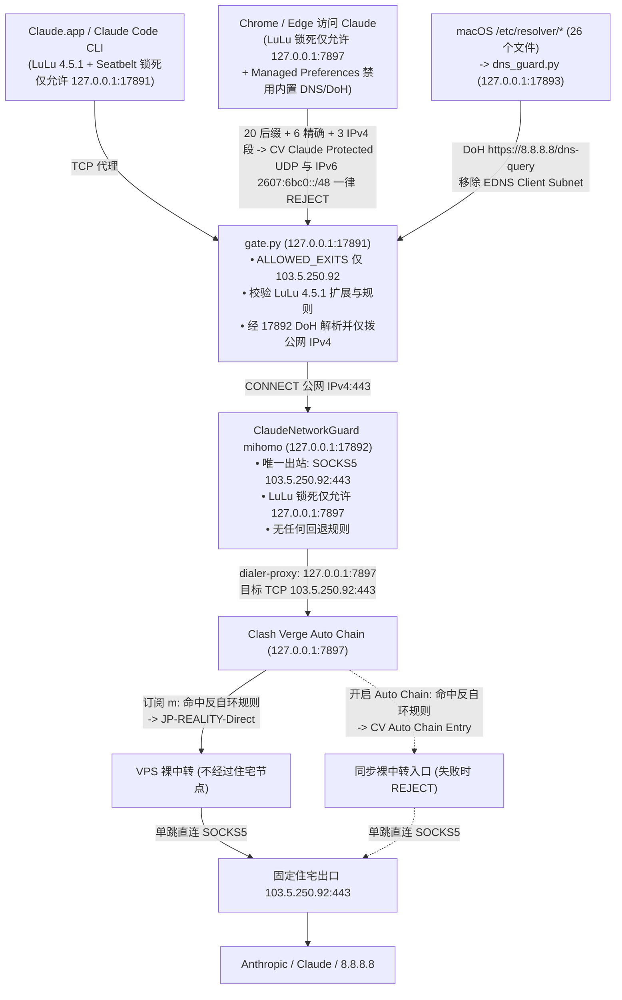
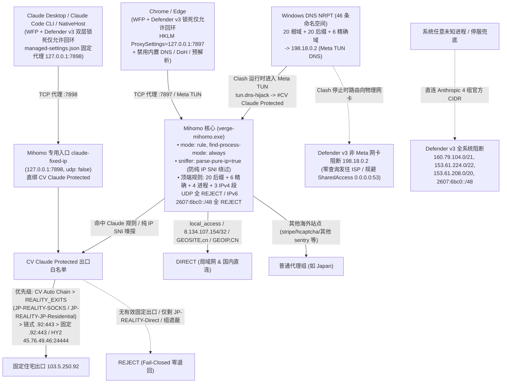

# Claude 固定出口全链路防护部署手册（macOS & Windows）

> **用途**：本文件记录 `clash-verge-rev`（个人维护分支 `dev`）配合本机系统级防护的完整架构、配置模板、防火墙与 DNS 规则、离线验收方法。重装系统或迁移新电脑时，可直接将本文件交给 AI 助手，按清单快速重建整套环境。
>
> **安全声明**：本文档**不包含任何真实密码、订阅链接、UUID、REALITY 公钥/Short-ID 或个人凭据**，所有敏感项均使用 `<PLACEHOLDER>` 占位，部署时请从本地加密备份中填入。
>
> 最后更新：2026-11-21（macOS 与 Windows 端均已按最新实装完成）。

---

## 1. 总体目标与安全铁律

1. **唯一允许出口**：Claude 相关所有流量（原生 App、Claude Code CLI、浏览器访问及对应 DNS）的公网出口**只允许固定住宅 IP `103.5.250.92`**。
2. **Fail-Closed（宁断不漏）**：Clash 未启动、中转节点中断、切换订阅/节点、或远端出口变化时，Claude 流量必须直接阻断（`REJECT` / `503` / `SERVFAIL`），**绝不自动退回 `DIRECT` 或其他普通节点**。
3. **零 DNS / IPv6 泄漏**：受保护域名不走本地 ISP / 浏览器自带 DoH；禁止 UDP（QUIC）与 IPv6 绕行。
4. **避免双层自环（Hairpin）**：如果日常代理节点本身已落地 `103.5.250.92`（例如 `JP-REALITY-JP-Residential` 或开启了 `CV Auto Chain`），到达 `103.5.250.92:443` 的传输连接必须经由纯净裸中转（`JP-REALITY-Direct` 或 `CV Auto Chain Entry`），避免 `103.5.250.92 -> 103.5.250.92:443` 自环导致延迟暴涨和超时断连。
5. **验收纪律**：**绝不使用真实 Claude 账号发测试消息**，也不在修改后直接拿线上配置做破坏性测试；全部逻辑均通过离线单测与本地回环隔离沙盒完成验收。

---

## 2. 仓库内置防护层（Clash Verge Auto Chain，跨平台通用）

仓库分支：`dev`（以 `77ccdcb0` 及之后提交为准）。

### 2.1 核心源码位置

| 文件 | 职责 |
|---|---|
| `src-tauri/src/enhance/claude_guard.rs` | 强制规则模式、注入受保护出站 `CV Claude Protected`、最高优先级 UDP `REJECT` + TCP 路由 + IP 段规则 + DNS `nameserver-policy` + 强制 `sniffer` 纯 IP SNI 嗅探、macOS 反自环规则、Windows 固定出口识别与国内分流保护 |
| `src-tauri/src/enhance/auto_chain.rs` | 构建 `CV Auto Chain` 完整链式代理组；定义保留组 `CV Auto Chain Entry` 与 `entry_name_for_route()` 唯一映射（找不到时 fail-closed 返回 `None` -> `REJECT`） |
| `src-tauri/src/core/auto_chain.rs` | 自动测速与故障切换；通过 `sync_entry_group()` 同步 `CV Auto Chain Entry` 到当前活跃路线的裸入口 |
| `src-tauri/src/enhance/mod.rs` | 在全局脚本、订阅规则及 `Auto Chain` 改写完成后最后施加 `claude_guard::enforce()` |
| `src-tauri/src/config/config.rs` | 序列化运行配置前再次施加 `claude_guard::enforce()`，防运行时链式编辑破坏保护 |
| `src-tauri/src/cmd/runtime.rs` | `get_claude_guard_status`：区分 macOS（校验 `127.0.0.1:17891` HTTP 出站）与 Windows（校验固定出口组） |

### 2.2 全量内置受保护目标（20 后缀 + 6 精确域名 + 3 IPv4 段 + 1 IPv6 段）

所有规则均自动生成在**全部 `DIRECT` / `GEOSITE,cn` / `GEOIP,CN` / `local_access` / `MATCH` 规则之前**，切换任何订阅均不会丢失：

1. **20 个域名后缀（`DOMAIN-SUFFIX` + UDP `REJECT` + `dns.nameserver-policy` `+.domain` 强制 `#CV Claude Protected`）**：
   - 核心 5 域：`claude.ai`、`claude.com`、`anthropic.com`、`claudeusercontent.com`、`anthropicusercontent.com`
   - 扩展 15 域：`anthropic.ai`、`anthropic.team`、`ant.dev`、`antspace.dev`、`chatbotclaude.com`、`clau.de`、`claude.app`、`claude.dev`、`claude.new`、`claude.site`、`claudeacademy.com`、`claudemcpclient.com`、`claudemcpcontent.com`、`claudepages.dev`、`claudestudio.com`
2. **6 个 Anthropic 专属精确域名（`DOMAIN` + UDP `REJECT` + `dns.nameserver-policy` 精确键强制 `#CV Claude Protected`，不误伤共用第三方网站）**：
   - `servd-anthropic-website.b-cdn.net`（官网静态资源 CDN）
   - `http-intake.logs.us5.datadoghq.com`（Claude Code Datadog 遥测）
   - `browser-intake-us5-datadoghq.com`（Claude 浏览器端 Datadog 遥测）
   - `o1158394.ingest.us.sentry.io`（Anthropic 专属 Sentry 组织）
   - `collector-pxvl48pwoc.px-cloud.net`（Anthropic 专属 PerimeterX 反机器人采集）
   - `lupk8zyo.messenger.intercom-chat.com`（Anthropic 专属 Intercom 客服）
3. **Anthropic 官方服务器 IP 段（AS399358，`no-resolve`）**：
   - IPv4（UDP `REJECT` + TCP 走 `CV Claude Protected`）：`160.79.104.0/21`（覆盖入站 `/23` 及出站）、`153.61.224.0/22`（入站）、`153.61.208.0/20`（出站）
   - IPv6（直接 `REJECT`，杜绝绕过纯 IPv4 出口）：`2607:6bc0::/48`
4. **不纳入全局强制的共用第三方域名**：`stripe.com`、`hcaptcha.com`、`intercom.io`、`google-analytics.com`、`sentry.io` 根域、`datadoghq.com` 根域等不拉入，避免影响其他网站（原生 Claude App/CLI 本身已由防火墙进程级锁死，不受影响）。

### 2.3 平台分支差异

- **macOS (`cfg!(target_os = "macos")`, `use_gateway = true`)**：
  - `CV Claude Protected` 固定为 `http://127.0.0.1:17891`（`udp: false`），对接本地 `ClaudeNetworkGuard` 闸门。
  - 自动在 Claude 保护规则之后、`DIRECT` 之前插入反自环规则：
    `AND,((NETWORK,TCP),(IP-CIDR,103.5.250.92/32,no-resolve),(DST-PORT,443)),<中转>`
    - 若开启 `CV Auto Chain`：生成隐藏组 `CV Auto Chain Entry`（`hidden: true`，首位 `REJECT`，其余为裸入口 `CV Chain / entry / <id>`），并由 `core/auto_chain.rs` 实时同步。
    - 若关闭 `CV Auto Chain` 且存在未遮蔽的有效 `JP-REALITY-Direct`（VLESS + TLS + REALITY，无 `dialer-proxy`）：路由到 `JP-REALITY-Direct`。
    - 普通机场订阅：不插此规则，由当前机场节点单跳直连 `103.5.250.92:443`。
- **Windows (`cfg!(target_os = "windows")`, `use_gateway = false`)**：
  - `claude_guard` 默认强制开启（`locked: true`），无需 `17891` 网关。
  - `CV Claude Protected` 仅接受 `CV Auto Chain`、服务端固定出口（`JP-REALITY-SOCKS` / `JP-REALITY-JP-Residential` / 钉死的 Hysteria2 出口）或指向 `103.5.250.92:443` 的 SOCKS5 链路；**严禁**选择 `JP-REALITY-Direct`；无有效固定出口时一律 `REJECT`。

---

## 3. macOS 完整系统级部署清单（重装系统快速重建）

### 3.1 完整防护路线图



### 3.2 前置软件与编译安装 Clash Verge Auto Chain

1. 安装基础工具：
   - Homebrew、Python 3（`/opt/homebrew/bin/python3`）、Rust (`rustup`)、Node.js + `pnpm`
   - **LuLu 4.5.1**（Objective-See，启用系统网络扩展 `com.objective-see.lulu.extension`）
   - 原生 `Claude.app` 与 `@anthropic-ai/claude-code`（`/opt/homebrew/bin/claude`）
2. 编译并安装定制版 `Clash Verge Auto Chain.app`：
   ```bash
   cd ~/private_projects/clash-verge-rev
   git checkout dev && git pull origin dev
   pnpm install
   pnpm tauri build --bundles app -c '{"bundle":{"createUpdaterArtifacts":false}}'
   # 产物位于：target/release/bundle/macos/Clash Verge Auto Chain.app
   # 复制到 /Applications/Clash Verge Auto Chain.app 后启动，安装并启用服务模式（TUN）
   ```
3. Clash Verge 关键配置（`~/Library/Application Support/io.github.clash-verge-rev.clash-verge-rev/`）：
   - `verge.yaml`：
     - `claude_guard_enabled: true`
     - `enable_tun_mode: true`
     - `enable_system_proxy: true`
     - `verge_mixed_port: 7897`
     - `enable_dns_settings: false`（由 `claude_guard::enforce_dns()` 统一接管 DNS 策略）
   - 全局 `profiles/Script.js`：开启 `sniffer`（`parse-pure-ip: true`、`force-dns-mapping: true`、`override-destination: false`，且 `skip-dst-address` 包含 `"103.5.250.92/32"` 与私网段），保留国内直连（`GEOSITE,cn,DIRECT`、`GEOIP,CN,DIRECT,no-resolve`）及自定义直连例外（如 Windows App 3389）。

### 3.3 `~/ClaudeNetworkGuard/` 目录与文件重建

目录权限：`chmod 700 ~/ClaudeNetworkGuard`。核心布局：

```text
~/ClaudeNetworkGuard/
├── bin/
│   ├── gate.py                    # 0700，本地 fail-closed HTTP 代理闸门 (127.0.0.1:17891)
│   ├── dns_guard.py               # 0644，本地分域 DoH 转发服务 (127.0.0.1:17893)
│   ├── install_dns_protection.py  # 管理员安装 26 个 /etc/resolver 与 Chrome/Edge 策略
│   ├── rollback_dns_protection.py # 按备份 manifest 精确回滚 DNS 策略
│   ├── claude                     # 0700，Claude Code CLI 沙盒启动包装器（放在 $PATH 最前）
│   ├── claude-desktop             # 0700，Claude.app 代理启动包装器
│   └── guardctl                   # 0700，LaunchAgents status/start/stop 管理脚本
├── proxy/
│   ├── mihomo                     # 独立 mihomo 二进制（可从 Clash Verge sidecar 复制）
│   ├── config.yaml                # 0600，固定 SOCKS5 后端配置（监听 127.0.0.1:17892）
│   ├── gate.sb                    # gate.py Seatbelt 策略（仅允许 localhost 出站）
│   ├── dns.sb                     # dns_guard.py Seatbelt 策略（仅允许连 17891、监听 17893）
│   └── client.sb                  # Claude CLI Seatbelt 策略（仅允许连 17891/5180/8080）
├── logs/                          # gate.log / backend.log / gate.error.log / backend.error.log
├── backups/                       # 历次变更备份
├── tests/                         # test_gate.py / test_dns_guard.py / isolated_full_anthropic_audit.py
└── status.json                    # gate.py 实时写入的验证状态
```

#### 1) `proxy/config.yaml`（权限 `0600`，填入真实凭据）
```json
{
  "mixed-port": 17892,
  "bind-address": "127.0.0.1",
  "allow-lan": false,
  "mode": "rule",
  "ipv6": false,
  "log-level": "warning",
  "proxies": [
    {
      "type": "socks5",
      "name": "Claude-Fixed-Upstream",
      "server": "103.5.250.92",
      "port": 443,
      "username": "<SOCKS5_USERNAME>",
      "password": "<SOCKS5_PASSWORD>",
      "dialer-proxy": "Clash-Current-Entry"
    },
    {
      "name": "Clash-Current-Entry",
      "type": "http",
      "server": "127.0.0.1",
      "port": 7897
    }
  ],
  "rules": ["MATCH,Claude-Fixed-Upstream"],
  "tun": {"enable": false},
  "dns": {"enable": false},
  "profile": {"store-selected": false, "store-fake-ip": false}
}
```

#### 2) 三个 Seatbelt 沙盒策略
- `proxy/gate.sb`：
  ```scheme
  (version 1)
  (allow default)
  (deny network-outbound)
  (allow network-outbound (remote ip "localhost:*"))
  ```
- `proxy/dns.sb`：
  ```scheme
  (version 1)
  (allow default)
  (deny network-outbound)
  (allow network-outbound (remote ip "localhost:17891"))
  (allow network-outbound (local ip "localhost:17893"))
  ```
- `proxy/client.sb`：
  ```scheme
  (version 1)
  (allow default)
  (deny network-outbound)
  (allow network-outbound (remote ip "localhost:17891"))
  (allow network-outbound (remote ip "localhost:5180"))
  (allow network-outbound (remote ip "localhost:8080"))
  ```

#### 3) `bin/gate.py` 关键设计不变量
- 监听 `127.0.0.1:17891`，上游仅 `127.0.0.1:17892`；禁止转发本地代理端口 `{7897, 17891, 17892}`，仅允许普通本地开发端口及公网 `80/443`。
- `ALLOWED_EXITS = frozenset({'103.5.250.92'})`；探针为 `api.ipify.org` 与 `checkip.amazonaws.com`。
- **硬安全违规（`SecurityError`，零重试立刻关闸并强杀全部活跃连接）**：
  - `firewall_ready()` 校验 LuLu 4.5.1 扩展激活、`disabled/allowLocalHost/useAllowList` 均为关、且 Claude / `proxy/*` / Chrome / Edge 必选 DENY+ALLOW 规则均存在；
  - 任一探针返回非 `103.5.250.92`；
  - 系统休眠或时钟回跳超过 `MAX_AGE`。
- **抗瞬时抖动参数**：`INTERVAL = 10`、`RETRY_INTERVAL = 3`、`PROBE_TIMEOUT = 12`、`CHECK_TIMEOUT = 15`、`SSL_HANDSHAKE_TIMEOUT = 10`、`TUNNEL_HANDSHAKE_TIMEOUT = 10`、`MAX_AGE = 45`、`MAX_TRANSIENT_FAILURES = 3`。
  - 关闸→开闸必须两个探针同时验证 `103.5.250.92`；
  - 已开闸时若无 IP 违规且至少 1 个探针新鲜验证成功则维持放行；若两个均瞬时超时则每 3 秒重试，连续 3 次失败或超 `45s` 即关闸。
- `resolve4()` 仅经 `17892` 访问 `https://8.8.8.8/resolve` 获取公网 IPv4 A 记录（拒绝 IPv6/私网 IP），带并发合并（Singleflight）与最长 `300s` TTL 缓存。

#### 4) `bin/dns_guard.py` 与系统级 DNS 安装
- 监听 `127.0.0.1:17893`（UDP + TCP），仅接受第 2.2 节的 **20 个后缀域（含子域）+ 6 个精确域名**，其他域名一律返回 `REFUSED (rcode 5)`；剥离 EDNS Client Subnet 后仅通过 `http://127.0.0.1:17891` 转发 DoH 到 `https://8.8.8.8/dns-query`，失败返回 `SERVFAIL (rcode 2)` 无回退。
- 启动服务后以管理员执行：
  ```bash
  sudo /opt/homebrew/bin/python3 ~/ClaudeNetworkGuard/bin/install_dns_protection.py
  ```
  自动完成：
  1. 在 `/etc/resolver/` 下生成全部 **26 个**域级解析文件（`nameserver 127.0.0.1`、`port 17893`、`search_order 1`、`timeout 5`）；
  2. 写入 `/Library/Managed Preferences/com.google.Chrome.plist` 与 `com.microsoft.Edge.plist`：
     `BuiltInDnsClientEnabled = false`、`DnsOverHttpsMode = "off"`、`NetworkPredictionOptions = 2`；
  3. 刷新 `dscacheutil -flushcache` 与 `killall -HUP mDNSResponder`。

#### 5) 启动包装器与 LaunchAgents
- `bin/claude`（确保 `~/.zshrc` 中 `export PATH="$HOME/ClaudeNetworkGuard/bin:$PATH"` 在 `/opt/homebrew/bin` 之前）：
  设置 `HTTP_PROXY`/`HTTPS_PROXY`/`ALL_PROXY`（大小写）为 `http://127.0.0.1:17891`、`NO_PROXY=''`、`CLAUDE_CODE_PROXY_RESOLVES_HOSTS=true`，并用 `sandbox-exec -f ~/ClaudeNetworkGuard/proxy/client.sb /opt/homebrew/bin/claude "$@"` 启动。
- `bin/claude-desktop`：同样设置上述代理环境变量并以 `--proxy-server=http://127.0.0.1:17891 --proxy-bypass-list=<-loopback>` 启动 `/Applications/Claude.app`。
- `~/Library/LaunchAgents/` 三个保活服务（`RunAtLoad=true`、`KeepAlive=true`）：
  1. `local.claude-network-guard.backend.plist`：启动 `~/ClaudeNetworkGuard/proxy/mihomo -d ~/ClaudeNetworkGuard/proxy -f ~/ClaudeNetworkGuard/proxy/config.yaml`（`NO_PROXY=*`）
  2. `local.claude-network-guard.gate.plist`：经 `sandbox-exec -f ~/ClaudeNetworkGuard/proxy/gate.sb` 启动 `gate.py`（`NO_PROXY=*`）
  3. `local.claude-network-guard.dns.plist`：经 `sandbox-exec -f ~/ClaudeNetworkGuard/proxy/dns.sb` 启动 `dns_guard.py`

### 3.4 LuLu 4.5.1 出站防火墙规则清单

全局偏好（`/Library/Objective-See/LuLu/preferences.plist`）：
- `disabled = false`、`allowLocalHost = false`、`useAllowList = false`、`passiveMode = false`。

必配应用规则（`DENY ^.*$:*` + 精确 `ALLOW`）：

| 进程 / 路径标识 | 必须配置 | 说明 |
|---|---|---|
| `/Applications/Claude.app/*`、`com.anthropic.claudefordesktop`、`com.anthropic.claudefordesktop.helper`、`com.anthropic.claude-code`、`/opt/homebrew/Caskroom/claude-code@latest/*`、`~/Library/Application Support/Claude/claude-code/*`、`ShipIt` | `DENY ^.*$:*` + `ALLOW 127.0.0.1:17891`（按需加本机开发端口 `5180`/`8080`） | 锁死原生 Claude 只能走 `17891` 闸门 |
| 其他 Anthropic 签名辅助二进制（`chrome-native-host`、`chrome_crashpad_handler`、`spawn-helper` 等） | `DENY *:*` | 禁止后台静默直连 |
| `~/ClaudeNetworkGuard/proxy/*` | `DENY ^.*$:*` + `ALLOW 127.0.0.1:7897` | 锁死 `17892` 后端只能通过主 Clash 建立隧道 |
| `/Applications/Google Chrome.app/*`、`/Applications/Microsoft Edge.app/*` | `DENY ^.*$:*` + `ALLOW 127.0.0.1:7897`（+ 本机回环 / 局域网段） | **注意**：清理/不要保留 `com.google.Chrome.helper`、`com.microsoft.edgemac(.helper)` 的宽泛签名 `ALLOW *:*` |
| `Clash Verge Auto Chain.app` 及 `verge-mihomo` | `ALLOW *:*` | 允许主代理核心联网 |

> **浏览器边界**：Safari（Apple 签名放行）与 Firefox（未受 Chrome/Edge 组策略约束）不在锁死范围内，**不要使用 Safari 或 Firefox 登录/访问 Claude**。

### 3.5 重装系统后的离线验收命令

```bash
# 1. 仓库 Rust 单测 + 全目标 Clippy
cd ~/private_projects/clash-verge-rev/src-tauri
cargo test --lib enhance
cargo clippy --all-targets --all-features -- -D warnings

# 2. 本地 Guard 离线单测
/opt/homebrew/bin/python3 ~/ClaudeNetworkGuard/tests/test_gate.py
/opt/homebrew/bin/python3 ~/ClaudeNetworkGuard/tests/test_dns_guard.py -v

# 3. 完全隔离的 Seatbelt 沙盒 Mihomo 全量路由/DNS/反自环/fail-closed 审计（零外网）
/opt/homebrew/bin/python3 ~/ClaudeNetworkGuard/tests/isolated_full_anthropic_audit.py

# 4. 运行态只读自检（不访问 Claude）
~/ClaudeNetworkGuard/bin/guardctl status
ls -1 /etc/resolver | wc -l          # 应为 26
/usr/bin/systemextensionsctl list | grep -i lulu
```

---

## 4. Windows 完整系统级部署清单（重装系统快速重建）

> **说明**：Windows 端采用独立应用标识 `Clash Verge Auto Chain`（`io.github.hello1999.clash-verge-auto-chain`）、独立 Windows 服务 `clash_verge_service_auto_chain`、内核级 WFP + Defender 防火墙双层防绕行、Windows DNS NRPT 分域锁定及 Chrome/Edge 机器级组策略。本文档同样**不包含任何密码、订阅链接、UUID 或私钥**。

### 4.1 完整防护路线图（Windows）



- **核心不变量（`cfg!(target_os = "windows")`, `use_gateway = false`）**：
  - `claude_guard::enabled()` 在 Windows 下恒为 `true`（`locked: true`），`check_mode()` 禁止切换至 `global` / `direct`。
  - `enforce_sniffer()` 强制开启 `sniffer`（`parse-pure-ip: true`、`force-dns-mapping: true`、`override-destination: false`，嗅探 `TLS 443/8443`、`HTTP 80/8080-8880`、`QUIC 443/8443`），彻底封堵通过缓存 IP / 第三方 CDN 纯 IP + TLS SNI 绕过域名规则的漏洞；`skip-dst-address` 自动豁免 `103.5.250.92/32`、回环/私网段及 `8.134.107.154/32`。
  - 严格排除 `JP-REALITY-Direct` 与 `JP-REALITY-US-Residential`；所有固定出口强制 `udp: false`；无可用出口时一律收缩为 `["REJECT"]`。

### 4.2 Windows Defender Firewall / WFP 出站锁死规则

> **Windows 防火墙铁律**：Windows Defender Firewall 中显式 `Block` **永远优先覆盖** `Allow`，**绝对不能**写成“Block `*` + Allow `127.0.0.1`”。必须采用**无重叠远端地址范围**或 **WFP 过滤条件**实现仅允许回环。

Windows 端采用 **WFP 持久过滤 + Defender 防火墙独立规则组** 双层纵深防护：

1. **第一层：安装包内置 WFP 持久过滤（自动随安装包部署并持续自愈）**
   - 核心文件：`src-tauri/packages/windows/claude-guard/{wfp-policy.h,manager.cpp,reconcile.ps1}`。
   - NSIS 安装器自动调用 `reconcile.ps1 -Action Install`，注册 SYSTEM 级计划任务 `Clash Verge Auto Chain Claude Guard`（开机、登录及每 1 分钟巡检）。
   - 自动发现并锁定以下全部路径（含自动更新版本目录）：
     - Claude Desktop AppX（`C:\Program Files\WindowsApps\Claude_*_x64__pzs8sxrjxfjjc\app\**\*.exe`，含 `claude.exe`、`cowork-svc.exe`、`chrome-native-host.exe`、`claude-ssh-*.exe`、`github-mcp-server.exe` 等）
     - AppX NativeHost 缓存（`%USERPROFILE%\AppData\Local\Packages\Claude_pzs8sxrjxfjjc\LocalCache\Roaming\Claude-NativeHost\<ver>\chrome-native-host.exe`）
     - Claude Code CLI 与版本目录（`%USERPROFILE%\.local\bin\claude.exe`、`%USERPROFILE%\.local\share\claude\versions\*`、`%USERPROFILE%\AppData\Roaming\Claude\claude-code\**\*.exe`）
     - 旧版安装目录（`%USERPROFILE%\AppData\Local\AnthropicClaude`、`%ProgramData%\<user>\AnthropicClaude`）
   - 策略：仅允许 `127.0.0.0/8` 与 `::1`，阻断一切非回环 IPv4/IPv6 出站（含 Clash 退出后依然持久生效）。巡检状态写入 `%ProgramData%\ClashVergeAutoChainProtection\auto-chain-guard-status.json`。
   - Chrome / Edge 同步由 WFP 持久规则登记在 `%ProgramData%\ClashVergeAutoChainProtection\applications.json`，仅允许回环访问（局域网请求经 `127.0.0.1:7897` 由 Clash `local_access` 直连）。

2. **第二层：Defender 防火墙加固脚本（`windows-package/Harden-WindowsClaudeGuard.ps1`，规则组 `Claude Guard Hardening v3`）**
   - **全系统 Anthropic 官方 IP 段兜底阻断（`Program = Any`, `Protocol = Any`, `Direction = Outbound`, `Action = Block`）**：
     - `ClaudeGuardV3-AnthropicIPv4-Block`：`160.79.104.0/21`、`153.61.224.0/22`、`153.61.208.0/20`
     - `ClaudeGuardV3-AnthropicIPv6-Block`：`2607:6bc0::/48`
     - **兼容性说明**：`verge-mihomo.exe` 仅拨号代理服务器 IP（如 `193.3.174.212`、`103.5.250.92`、`45.76.49.46` 等），绝不直连 Anthropic 官方 IP 段；浏览器与 Claude 走代理端口（`7897`/`7898`）或 TUN fake-ip（`198.18.0.0/16`），不受影响；反而能在 Clash 停服、未知进程直连或核心异常退回 `DIRECT` 时从内核层直接截断。
   - **Claude + Chrome / Edge 全二进制无重叠非回环阻断**：
     - 针对本机全部发现的 Claude 二进制及 `chrome.exe`、`msedge.exe`，使用无重叠远端范围 `0.0.0.0-126.255.255.255` + `128.0.0.0-255.255.255.255`（IPv4）与 `::2-ffff:ffff:ffff:ffff:ffff:ffff:ffff:ffff`（IPv6），`Protocol = Any`（覆盖 TCP + UDP/QUIC）。
   - **不干扰常规软件**：Firefox 及其他未列入名单的常规应用不受进程级阻断（但仍受全系统 Anthropic 4 组 IP 段兜底阻断；**不要使用 Firefox 登录/访问 Claude**）。

### 4.3 Windows DNS 防泄漏（NRPT / `hosts` / 浏览器策略）

1. **为什么 NRPT 指向 `198.18.0.2` 而不是 `127.0.0.1`**：
   - Windows 启用 Hyper-V 默认交换机时，`SharedAccess`（ICS 服务）会绑定 `0.0.0.0:53`。若把 NRPT 指向 `127.0.0.1`，系统 DNS 查询会命中 ICS 并被静默转发至物理网卡路由器/ISP DNS（如 `192.168.5.1`），造成严重 DNS 泄漏。
   - Clash TUN 网卡 `Meta` 固定提供虚拟 DNS `198.18.0.2`（`198.18.0.0/30` on-link），并由 `tun.dns-hijack: [any:53, tcp://any:53]` 接管。
   - 因此加固脚本执行两步联动：
     1. 通过 `Add-DnsClientNrptRule` 为全部 20 个后缀（同时写入根域 `domain` 与后缀 `.domain`，共 40 条）+ 6 个精确主机名（6 条），合计 **46 条命名空间**指定 `-NameServers 198.18.0.2`（标签 `ClaudeGuardHardeningV3`）。
     2. 在 Defender 防火墙创建 `ClaudeGuardV3-NrptDnsNonMeta-Block`，在所有非 `Meta` 网卡（`以太网`、`WLAN`、`vEthernet` 等）上出站阻断 `198.18.0.2`。
     - **Clash 运行时**：`198.18.0.2` 走 `Meta` 网卡 → 命中 `tun.dns-hijack` → 按 `nameserver-policy` 走 `1.1.1.1`/`8.8.8.8#CV Claude Protected`（固定出口 `.92`）。
     - **Clash 停止时**：`Meta` 消失 → Windows 尝试经物理网卡发往 `198.18.0.2` → 被防火墙直接丢弃，**零外泄、不触碰 ICS**。
2. **`C:\Windows\System32\drivers\etc\hosts` 边界**：
   - 保持 `hosts` 中**无任何 Claude / Anthropic 黑洞条目**（严禁写成 `0.0.0.0 claude.ai`，否则 Windows DNS Client 会在进入代理/TUN 前直接返回 `0.0.0.0` 破坏正常访问）。
3. **Chrome / Edge 机器级注册表组策略（`HKLM`）**：
   - 注册表路径：`HKLM:\Software\Policies\Google\Chrome` 与 `HKLM:\Software\Policies\Microsoft\Edge`
   - 必须同时生效的 4 项策略：
     - `ProxySettings`（`REG_SZ`）：`{"ProxyMode":"fixed_servers","ProxyServer":"127.0.0.1:7897","ProxyBypassList":"<-loopback>"}`
     - `BuiltInDnsClientEnabled`（`REG_DWORD`）：`0`（强制走系统 DNS/代理，禁用 Chromium 内置异步 DNS）
     - `DnsOverHttpsMode`（`REG_SZ`）：`"off"`（禁止浏览器自带 DoH 经 `7897` 普通节点泄漏 Claude DNS）
     - `NetworkPredictionOptions`（`REG_DWORD`）：`2`（禁止预解析与预连接）
   - 写入后在 `chrome://policy` 与 `edge://policy` 点击“重新加载策略”确认 4 项均为已采纳。
4. **Mihomo 内置 DNS 面（由 `claude_guard::enforce_dns()` 自动注入）**：
   - `dns.enable: true`、`prefer-h3: false`、`respect-rules: false`、`direct-nameserver-follow-policy: true`、`fallback: []`。
   - 26 个 Anthropic 域名强制走 `#CV Claude Protected`；6 个本地域（`localhost`/`lan`/`local`/`home.arpa`/`in-addr.arpa`/`ip6.arpa`）走 `system`；22 个国内常用域走 `223.5.5.5`/`223.6.6.6#DIRECT`；其余公共域走 `#<MATCH目标组>`（若 `MATCH` 为 `DIRECT` 或缺失则退为 `#REJECT`）。

### 4.4 Windows 端构建、安装与本地配置要点

1. **构建定制版 Windows 安装包**：
   - 配置文件：[src-tauri/tauri.windows.conf.json](../src-tauri/tauri.windows.conf.json)（产品名 `Clash Verge Auto Chain`、标识 `io.github.hello1999.clash-verge-auto-chain`、自动编译并打包 `claude-guard-manager.exe` 与 `reconcile.ps1`）。
   - 每次发布新版高于本机已安装版本时递增 `tauri.windows.conf.json` 中的 `version`（例如 `2.5.16`），以允许 NSIS 原地升级。
   - 构建命令（需 Node 22/24 + `pnpm` + Rust MSVC + VS C++ Build Tools）：
     ```powershell
     pnpm build
     # 产物位于：target\release\bundle\nsis\Clash Verge Auto Chain_<version>_x64-setup.exe
     ```
2. **安装与目录结构**：
   - 安装目录：`C:\Program Files\Clash Verge Auto Chain\`（含 `clash-verge-auto-chain.exe`、`verge-mihomo.exe`、`resources\claude-guard-manager.exe`、`packages\windows\claude-guard\reconcile.ps1`）。
   - 数据目录：`%APPDATA%\io.github.hello1999.clash-verge-auto-chain\`（与上游原版完全隔离）。
   - `verge.yaml` 关键项：`claude_guard_enabled: true`、`enable_tun_mode: true`、`enable_system_proxy: true`、`verge_mixed_port: 7897`、`enable_dns_settings: false`、`system_proxy_bypass: localhost;127.*;[::1]`（确保 LAN 请求经 `7897` 命中 `local_access` 直连规则）。
   - Claude Code CLI 受管代理配置：`C:\Program Files\ClaudeCode\managed-settings.json`：
     ```json
     {
       "env": {
         "HTTP_PROXY": "http://127.0.0.1:7898",
         "HTTPS_PROXY": "http://127.0.0.1:7898",
         "NO_PROXY": "localhost,127.0.0.1,::1"
       }
     }
     ```
   - 局域网与国内分流核对：`claude_guard::enforce()` 在 Windows 下自动于 Claude 规则之后保留 `local_access::RULES`（私网/回环 `DIRECT`），并在 `MATCH` 之前自动维护 `IP-CIDR,8.134.107.154/32,DIRECT,no-resolve`、`GEOSITE,cn,DIRECT`、`GEOIP,CN,DIRECT` 以及 `tun.route-exclude-address: [8.134.107.154/32]`（确保 FRP/RDP 服务器与国内直连不受影响）。

### 4.5 Windows 离线隔离验收与回滚清单

1. **Rust 单测与 Clippy（在 `src-tauri` 下执行）**：
   ```powershell
   # Windows MSVC 需启用 --features clippy 以嵌入 Common Controls v6 清单解析 TaskDialogIndirect
   cargo test --features clippy --lib enhance
   cargo test --features clippy --lib claude_guard
   cargo test --features clippy --lib auto_chain
   cargo clippy --lib --tests -- -D warnings
   ```
   重点确认 4 项 Windows/核心回归单测通过：`reality_exit_and_lan_routes_survive_regeneration`、`domestic_routes_survive_cached_runtime_and_keep_protection_first`、`pinned_hysteria_exit_survives_renames_and_rejects_unsafe_variants`、`sniffer_and_jp_residential_exit_are_enforced_without_gateway`。

2. **独立离线 `verge-mihomo.exe` 校验（零外网、零现网）**：
   - 使用临时目录 + `127.0.0.1` 随机端口 + 本地 Mock 上游，依次验证：
     - `verge-mihomo.exe -t` 校验 `JP-REALITY-JP-Residential` / `JP-REALITY-SOCKS` / `JP2-HY2-SOCKS` / `CV Auto Chain` / 仅 `JP-REALITY-Direct` 断闸配置；
     - 全部 20 后缀（根+子域）、6 精确域、3 组 IPv4 CIDR、纯 IP TLS SNI 嗅探全部命中 `CV Claude Protected`；IPv6 `2607:6bc0::/48` 被 `REJECT`；固定出口缺失/故障时 100% fail-closed；`stripe.com` / `hcaptcha.com` / 其他 `sentry.io` / `datadoghq.com`、回环/LAN 与国内站无误伤；
     - 离线 DNS 46 项 Anthropic 查询在受保护出口 `REJECT` 时零外泄。

3. **安装包非执行哈希核验（不运行安装程序）**：
   ```powershell
   powershell.exe -NoProfile -ExecutionPolicy Bypass -File "windows-package\Verify-Package.ps1" -Installer "target\release\bundle\nsis\Clash Verge Auto Chain_<version>_x64-setup.exe"
   ```

4. **系统级加固部署、只读审计与一键回滚（管理员 PowerShell）**：
   ```powershell
   # 只读审计（普通/管理员权限均可）
   powershell.exe -NoProfile -ExecutionPolicy Bypass -File "windows-package\Harden-WindowsClaudeGuard.ps1" -Action Audit

   # 应用加固（自动备份防火墙 .wfw、hosts、NRPT、浏览器策略到 C:\ProgramData\ClashVergeAutoChainProtection\hardening-backups\）
   powershell.exe -NoProfile -ExecutionPolicy Bypass -File "windows-package\Harden-WindowsClaudeGuard.ps1" -Action Apply

   # 巡检 WFP 持久规则（升级安装后可选）
   powershell.exe -NoProfile -ExecutionPolicy Bypass -File "C:\Program Files\Clash Verge Auto Chain\packages\windows\claude-guard\reconcile.ps1" -Action Audit

   # 按备份目录精确回滚（仅撤销 Claude Guard Hardening v3 新增项，不动 WFP 与 ProxySettings）
   powershell.exe -NoProfile -ExecutionPolicy Bypass -File "windows-package\Harden-WindowsClaudeGuard.ps1" -Action Restore -BackupDirectory "C:\ProgramData\ClashVergeAutoChainProtection\hardening-backups\backup-<TIMESTAMP>"
   ```
